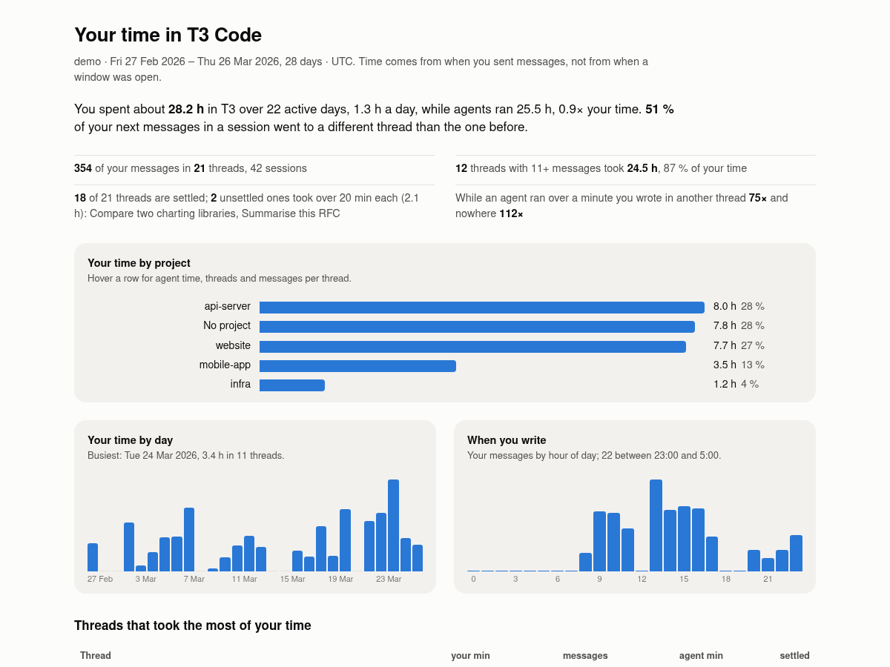

# t3-time

How much of **your own** time each [T3 Code](https://github.com/pingdotgg/t3code) thread and project takes, across
all your machines.

**Cost:** one read of T3's database, a few seconds. A single Python file, standard library only. No daemon, nothing
runs in the background, nothing is written to T3. It is not a fork or a plugin of T3 Code, just a reader of its local
database.



## Install and run

```sh
curl -LO https://raw.githubusercontent.com/Gooder24/t3-time/main/t3time.py
python3 t3time.py                          # this machine
python3 t3time.py --html time.html         # plus a standalone page (light and dark)
```

Python 3.9 or newer. It reads `~/.t3/userdata/statev2.sqlite` with `mode=ro`.

### More machines

All your messages from all machines go into one stream, so switching between threads on two machines counts too.

```sh
python3 t3time.py --ssh laptop --ssh server   # runs `ssh HOST python3 - --extract` with this file on stdin
python3 t3time.py --db pc=./statev2.sqlite    # a copied database, e.g. from Windows without Python
```

`--ssh` needs only `python3` on the other machine; nothing is installed there. To copy a database T3 is using, take a
consistent snapshot (`sqlite3 ~/.t3/userdata/statev2.sqlite ".backup statev2.sqlite"`) or copy the `-wal` file with it.
The same machine given twice, or a thread that exists on two machines, is counted once.

### Options

| Option | |
|---|---|
| `--ssh HOST` | add another machine over ssh (repeatable) |
| `--db [LABEL=]PATH` | add a copied `statev2.sqlite` (repeatable) |
| `--no-local` | skip this machine |
| `--since YYYY-MM-DD` | only from this day on |
| `--tz ZONE` | time zone for days and hours, e.g. `Europe/Berlin` (default: the system's, with daylight saving) |
| `--idle MIN` | longest gap between two messages that still counts as active (default 15) |
| `--html FILE` | write a standalone HTML page |
| `--json` | print all results as JSON instead of the summary |

## What it measures

Like WakaTime: a gap of up to 15 minutes between two of your messages, across all threads and machines, counts as
active time for the thread of the later message; the first message of a session gets 60 seconds.

**Hours are an estimate.** T3 does not record typing, focus or reading, so expect roughly ±30 %. Exact are: the
number and times of your messages, their order (so how often you switch threads), agent run times and whether a
thread is settled.

It shows your time in total and per day, agent time and its ratio to yours, how often your next message in a session
goes to a different thread, threads with 11+ messages and their share of your time, unsettled threads with over
20 minutes of your time, what you did while an agent ran longer than a minute (wrote in another thread, or nowhere,
which can also mean you were away), and breakdowns by project, day, hour of day and thread.

"Your messages" are the user messages T3 marks as created by you, from the app (`web`) or queued on the server
(`server`). Left out: agent and delegated messages, T3's automatic `/compact`, "Resumed thread" notices, empty
messages, and the server's own "Continue where you left off." after a usage-limit reset (clicking Continue yourself
counts). Settled means a thread was ended, by you or by an agent, not that it worked. Agent time adds up every
finished run, including delegated and scheduled threads you never wrote in.

## When T3 changes

t3-time does not follow T3's code. If a T3 update renames the tables or columns it reads, it stops with a message that
names what is missing instead of guessing. Please open an issue with your T3 version.

## Development

```sh
python3 -m unittest -v test_t3time   # synthetic databases only, about 4 s
python3 demo.py demo.sqlite && python3 t3time.py --no-local --db demo=demo.sqlite --tz UTC --html demo.html
```

MIT license.
